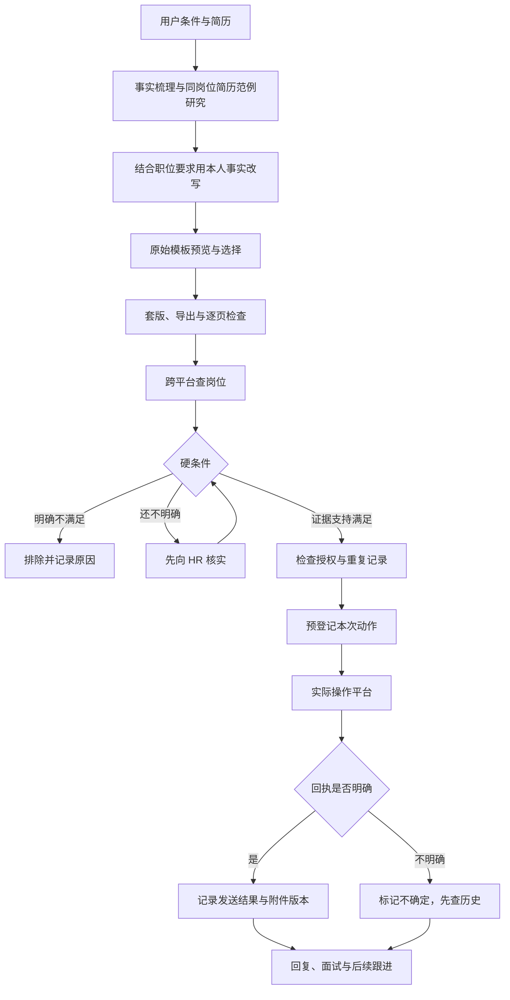

# Job Search Copilot · 自动求职工作流 Skill

把求职交给 Agent 持续推进：读简历、整理真实经历、选择模板、搜索岗位、核实条件、投递、沟通和跟进。每次操作留下记录，随时能看清哪些岗位值得继续、哪些已经发出、哪些还需要本人处理。

适用于 Codex 等能够读取 `SKILL.md`、联网检索、操作招聘页面和处理本地文档的 Agent。主要面向中文求职场景，条件由求职者配置，行业、城市、薪资和平台都不固定。

## 能做什么

- 把原始简历、个人项目和用户补充整理为有来源的事实；默认自动检索同岗位、同资历的优秀简历/公开范例，结合职位要求借鉴结构和表达，再用本人经历改写，并给出参考来源。
- 从用户指定的模板仓库或模板站挑选原始版式，先给预览再套入内容，保留照片和结构特点。
- 跨平台发现职位，分别核实固定工资、休息制度、办公地点、门到门通勤、实际业务和用工主体。
- 在明确授权范围内向招聘方发问、投递并跟进；需要扫码或验证时交给本人，其他工作继续推进。
- 记录职位、条件证据、附件版本、操作回执和回复，防止超时后重复投递。
- 用本地 SQLite 台账生成 JSON/CSV 汇总。台账脚本使用 Python 标准库，不读取浏览器凭据，也不直接发送消息。

“自动”指 Agent 在已授权范围内主动推进。扫码、验证码、平台要求的人工确认、面试时间承诺、接受 offer 和签约仍需要按实际授权与工具规则处理。没有后台运行能力时，Skill 不会在对话结束后自行监控。

## 安装

```bash
git clone https://github.com/oneAI6/job-search-copilot-skill.git
mkdir -p ~/.codex/skills
cp -R job-search-copilot-skill/skills/job-search-copilot ~/.codex/skills/
```

其他支持 Agent Skills 的工具可将 `skills/job-search-copilot` 整个目录放入其技能目录。技能中的参考文件和脚本需一并保留。

## 开始求职

在支持 Skill 的 Agent 中输入：

```text
使用 $job-search-copilot，读取我提供的简历，帮我找工作并持续投递沟通。
我的条件是：城市/区域、目标固定月薪、休息制度、通勤上限、岗位方向、排除行业。
我允许你操作的平台是……，允许发送的简历/联系方式是……。
已有模板或模板仓库优先使用我提供的。
```

信息不全时，Agent 应先从已有对话和文件补齐；只询问影响判断的缺口。个人数据保存在任务自己的私有目录，公开仓库不接收真实简历、照片、联系方式和招聘聊天记录。

## 台账快速体验

以下文件全部是虚构示例。脚本只维护本地记录；真实投递依赖 Agent 实际操作招聘平台。

```bash
cd job-search-copilot-skill
python3 skills/job-search-copilot/scripts/job_tracker.py init \
  --profile examples/profile.example.json
python3 skills/job-search-copilot/scripts/job_tracker.py add \
  --platform example --url https://jobs.example.org/jobs/content-001 \
  --company '示例内容工作室' --title '内容运营专员'
python3 skills/job-search-copilot/scripts/job_tracker.py list
```

默认工作目录是当前目录的 `.private/job-search`，默认只准备草稿。实际授权由用户决定并写入私有 `profile.json`；示例不会自动授权外发。

详细命令、状态和证据要求见 [台账说明](skills/job-search-copilot/references/tracker.md)。默认忽略私有工作目录，但忽略规则不是脱敏工具，公开前仍需检查实际文件。

## 工作流



## 来自实际执行的改进

模板先看原图、再由用户选；不同样张需体现栏宽、照片位置、标题结构和信息组织的区别。个人内容项目、已毕业状态、演出身份和产品上线状态分别核实。职位失效后，新职位需要重新核实条件，不能继承旧标题的“双休”。

招聘页的“已打招呼”“消息送达”“附件已发送”“简历已投递”“获得面试”是不同结果；发送中断时先查历史，不能用一次点击或一个超时替代结果证明。

这些流程来自真实任务经验。平台界面会变化：智联流程有实际沟通和附件发送经验；BOSS及其他平台仍需在当前账户与页面上逐项验证。仓库提供操作指导与台账，不提供招聘平台私有接口或稳定适配承诺。

## 模板资源

- [ResumeCollection](https://github.com/mmmlllnnn/ResumeCollection)：用户提供的模板集合，包含中文简历和 Word 文件。
- [五百丁](https://www.500d.me/cvresume/)：中文模板原始预览。

优先使用用户指定的模板。本项目仅链接第三方资源，不打包其模板、照片、截图或字体；具体模板的使用范围以原作者许可为准。

## 验证与开发

```bash
python3 -m unittest discover -s tests -v
python3 skills/job-search-copilot/scripts/job_tracker.py --help
```

测试覆盖硬条件拦截、授权范围、重复职位、不确定结果、附件版本和 CSV 导出。测试通过表示本地台账行为通过验证，平台投递仍需实际回执。

MIT License，欢迎通过 Issue 和 Pull Request 改进平台操作经验。提交内容请使用虚构案例，保护求职者与招聘方隐私。
