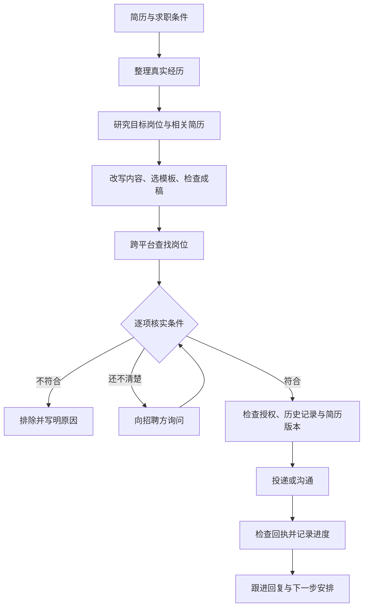

# yulan OfferPilot｜求职领航

**让 AI 全自动帮你改简历、找岗位、投递和跟进。**

你提供简历、求职条件和操作授权，它负责整理材料、筛选岗位、准备沟通内容，并在工具和平台允许的情况下完成投递。你随时能看到：哪些岗位符合条件，哪些还没问清楚，哪些已经联系过，下一步该做什么。

交给codex，30分钟省去你一天2小时的投递时间。

就是一句话：全自动！从简历修改到投递沟通，全平台覆盖。别再投简历上浪费时间了，交给它，安心睡觉吧。

祝你早日拿到心仪的offer

## 它能帮你做什么

| 环节 | 具体怎么做 |
|---|---|
| 梳理经历 | 从原始简历、个人项目和补充信息里整理事实，找出适合目标岗位的经历；转行时，也会分析可以尝试的相邻岗位和能力缺口。 |
| 参考同岗位简历 | 默认搜索与你目标岗位、经验水平接近的公开简历和写作案例，优先中文资料，结合真实招聘要求改写，并保留参考来源。 |
| 优化内容与排版 | 把项目里做了什么、用了什么方法、取得什么结果写清楚；先看模板原图再选版式，支持照片、按岗位准备不同版本，以及导出后的逐页检查。 |
| 找岗位、核实条件 | 按城市、固定工资、休息制度、办公地点、通勤上限和排除行业筛选。不确定的条件单独列出来，再向招聘方确认。 |
| 投递与沟通 | 在你允许的平台和范围内，结合具体岗位写招呼、询问关键条件、发送对应简历，并根据 HR 回复继续沟通。 |
| 记录与跟进 | 保存岗位链接、条件来源、简历版本、发送结果和下一步安排；支持本地查询与 JSON、CSV 导出，续聊时可以接着推进。 |

## 几个比较亮点的地方

**简历会先做功课。** 全面优化时，先看目标岗位需要什么，再参考相关简历怎么表达。借鉴结构和写法，用的仍然是你自己的经历；不会把别人的业绩、工作年限或工具能力写到你头上。

**你的条件会落实到每个岗位。** 比如你要求固定工资和周末双休，就要分别核实工资组成与休息安排。招聘页写“月薪 8–12k”，还需要看其中多少是固定工资；写“月休八天”，也需要确认具体怎么休。

**模板先让你看，再往里填。** 可以优先用你提供的模板或模板仓库。预览时展示原始版式，选定后尽量保留布局、照片位置和信息结构，便于比较和修改。

**每次投递都查结果。** 打招呼、消息送达、附件上传、附件发送和正式申请分别记录。发送超时后先查历史，避免一遍遍给同一个 HR 发相同内容。

**能按你的节奏用。** 只改简历、只找岗位、先准备草稿，或授权后继续投递都可以。信息已经在对话里确认过，就接着用；关键缺口集中问，减少来回补充。

## 使用前需要什么

这是一个给 AI 助手使用的 Skill，需要宿主具备相应能力：读取本地文件、联网搜索、操作浏览器，以及制作文档。以 Codex 为主要使用环境；其他支持 Agent Skills 的工具，也需要检查是否具备这些能力。

仓库包含求职流程说明、操作参考和一个 Python 本地记录工具。实际搜索、改简历和投递由 AI 助手调用可用工具完成，单独运行 Python 脚本只会管理记录。

## 自动做到哪一步

你授权后，AI 可以主动继续搜索、准备材料和操作可用的招聘页面。遇到扫码、短信、验证码或平台要求本人处理的步骤，仍可能需要你接手。面试时间、入职日期、接受 offer 和签约按你的安排决定。

平台支持取决于当前工具、账号和页面。智联已有实际 HR 沟通和简历附件发送经验；前程无忧验证过公开岗位搜索。BOSS、猎聘、拉勾、脉脉等渠道还存在页面加载、访问验证或登录限制，尚未验证完整投递流程。企业官网可以查找公开招聘信息，邮件发送还需要可用的发件工具与账号。

目前没有“所有平台稳定自动投递”的能力承诺，也没有内置后台常驻服务。对话结束后能否继续运行，取决于宿主是否提供并已配置自动化。求职结果也取决于岗位匹配和招聘方判断。

## 安装和开始使用

在终端执行：

```bash
git clone https://github.com/oneAI6/yulan-offerpilot.git
mkdir -p ~/.codex/skills
cp -R yulan-offerpilot/skills/job-search-copilot ~/.codex/skills/
```

其他支持 Agent Skills 的工具，可将 `skills/job-search-copilot` 整个目录放入对应技能目录；参考文件和脚本需一起保留。

然后把简历提供给 AI 助手，像平时聊天一样说明要求：

```text
使用 $job-search-copilot，帮我整理简历并找工作。

目标岗位：内容运营，也可以看看与我经历匹配的其他方向。
求职条件：填写城市、期望固定工资、休息要求、通勤上限和不考虑的行业。
简历要求：参考同岗位的优秀简历，先给我看模板，再按选定版式制作。
操作范围：先搜索和准备材料；要发送时，使用我明确允许的平台、简历和联系方式。
如果我已经授权投递，请按授权范围继续，并记录每次结果。
```

可以只说“帮我优化这份简历”或“继续跟进已经联系的岗位”，不必每次重走全部流程。要扩大投递范围时，再补充允许操作的平台和可发送的材料。

## 一次完整求职会怎么走



每批工作结束后，会汇总候选岗位、排除原因、已核实条件、实际询问和投递结果、HR 回复及待处理事项。已发送和符合条件分别统计，方便你判断下一步。

## 资料和记录放在哪里

真实简历、照片、联系方式和招聘聊天记录保存在任务自己的私有目录。公开仓库只提供流程、工具和虚构示例，不收集求职者资料。

本地记录工具使用 Python 标准库和 SQLite，不读取浏览器密码或登录凭据，也不直接发送申请。默认目录为当前目录下的 `.private/job-search`；示例配置默认只准备草稿。

分享工作目录前仍需检查其中的个人资料，`.gitignore` 不能替你完成脱敏。

## 本地记录工具

以下命令使用虚构示例，只演示岗位记录：

```bash
cd yulan-offerpilot
python3 skills/job-search-copilot/scripts/job_tracker.py init \
  --profile examples/profile.example.json
python3 skills/job-search-copilot/scripts/job_tracker.py add \
  --platform example --url https://jobs.example.org/jobs/content-001 \
  --company '示例内容工作室' --title '内容运营专员'
python3 skills/job-search-copilot/scripts/job_tracker.py list
```

开发检查：

```bash
python3 -m unittest discover -s tests -v
python3 skills/job-search-copilot/scripts/job_tracker.py --help
```

测试覆盖条件检查、授权范围、重复操作、不确定结果、附件版本和 CSV 导出。它验证的是本地记录工具，实际平台投递需要单独核对回执。

## 进一步了解

- [Skill 主入口](skills/job-search-copilot/SKILL.md)
- [简历优化、同岗位案例研究与模板选择](skills/job-search-copilot/references/resume-and-templates.md)
- [岗位筛选与条件核实](skills/job-search-copilot/references/screening.md)
- [招聘平台操作与沟通](skills/job-search-copilot/references/platform-operations.md)
- [本地记录工具的完整用法](skills/job-search-copilot/references/tracker.md)

可参考的第三方模板资源：[ResumeCollection](https://github.com/mmmlllnnn/ResumeCollection)、[五百丁](https://www.500d.me/cvresume/)。优先使用你指定的模板；本仓库仅提供链接，不打包第三方模板、照片或字体，使用时以原作者许可为准。

由 **yulan** 整理并开源，采用 [MIT License](LICENSE)。欢迎提交 Issue 或 Pull Request，补充真实遇到的问题和平台操作经验；示例请使用虚构或已脱敏的资料。
